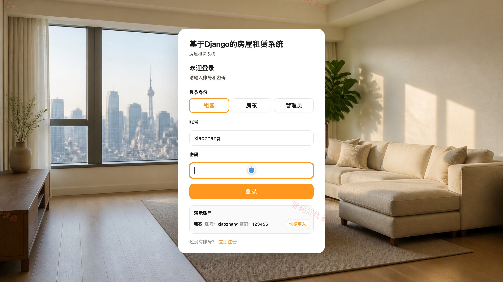
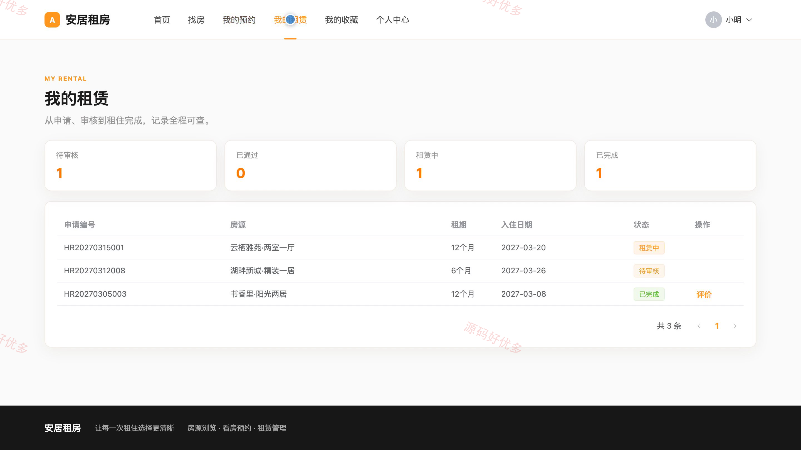
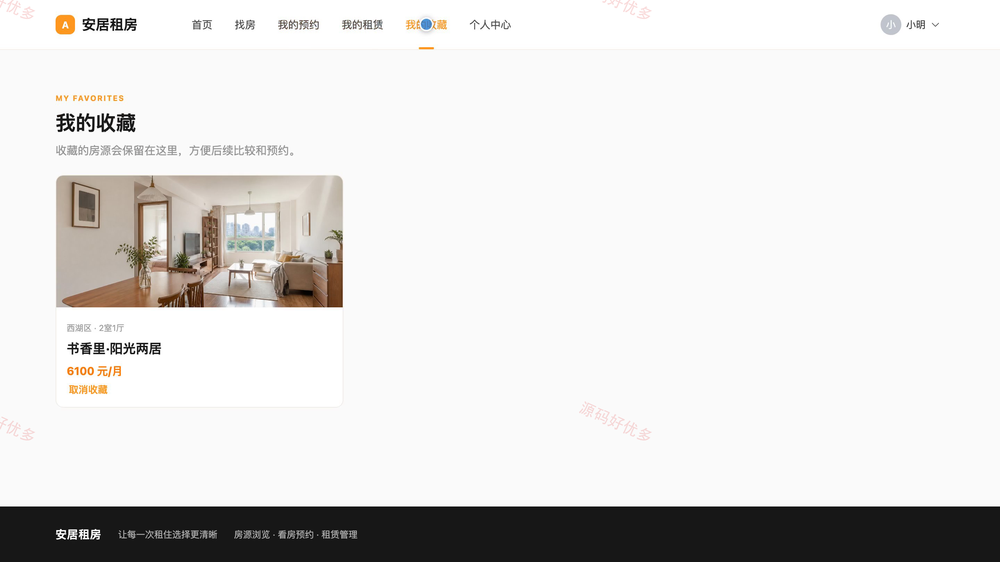
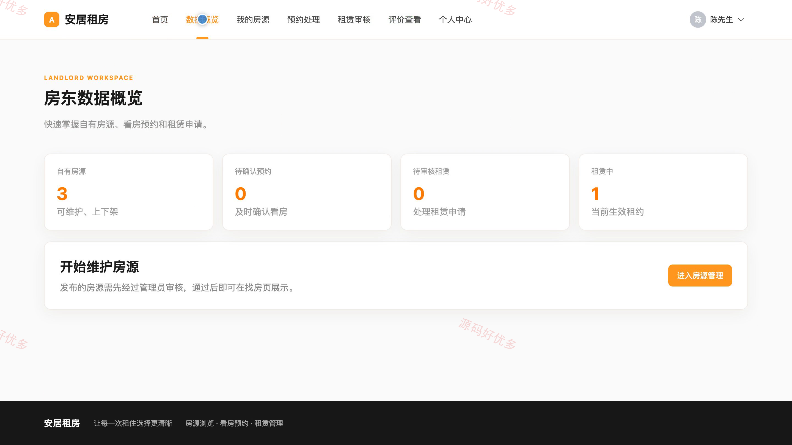
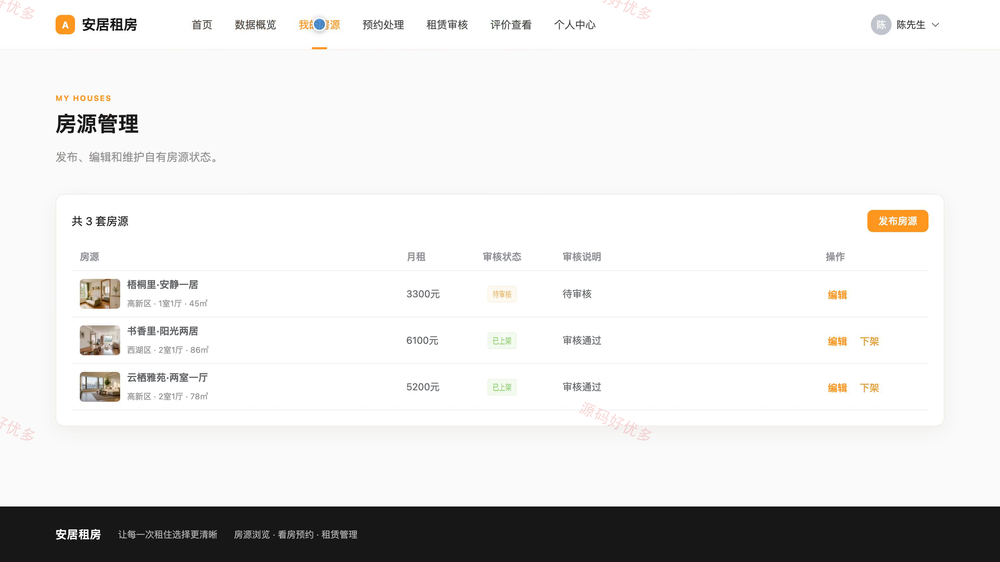
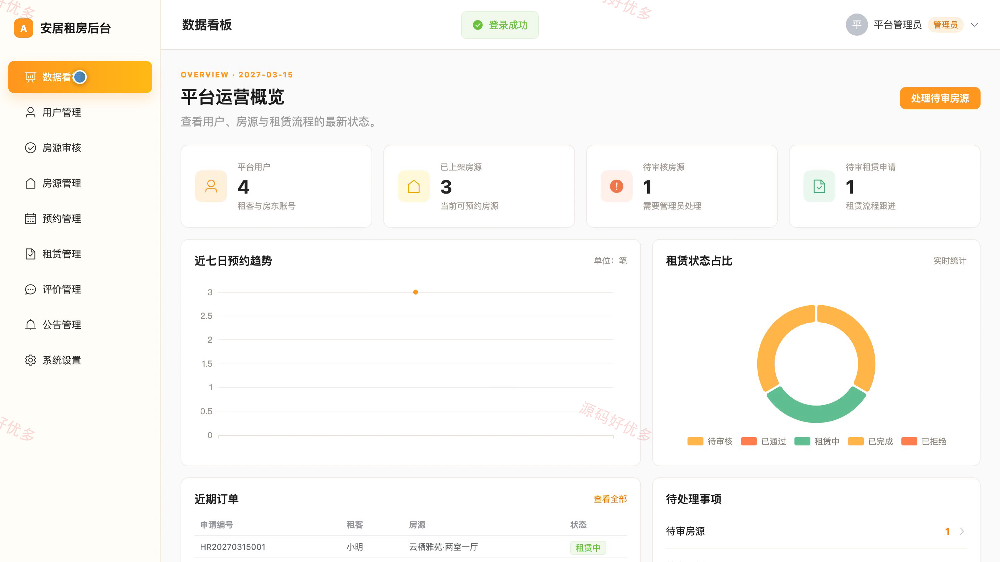
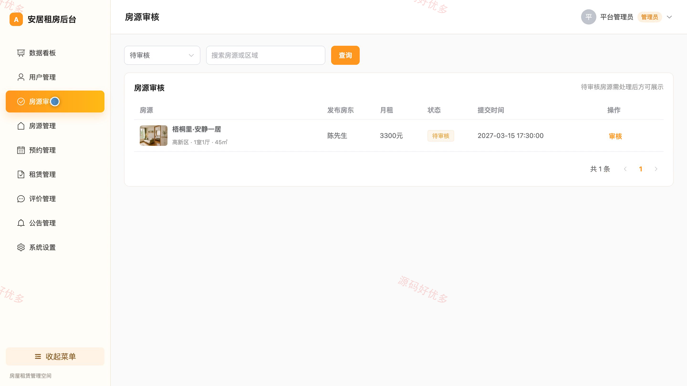
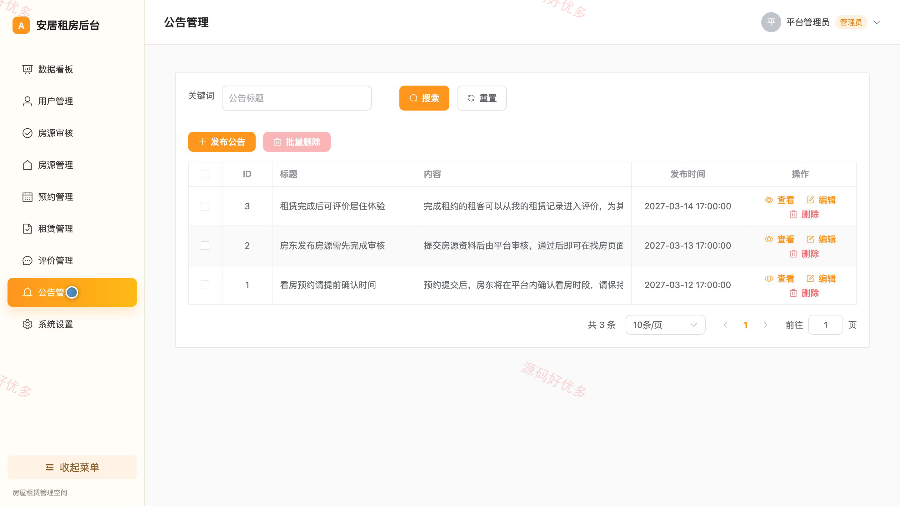

# bs047C
bs047C基于Django的房屋租赁系统源码 Python Django Vue3 设计文档 PPT
## 源码问题查看主页咨询

### 一、关键词
房屋租赁、在线找房、房源出租、看房预约、租房管理

### 二、作品包含
源码+数据库+万字设计文档+PPT+全套环境和工具资源+本地部署教程

### 三、项目技术
前端技术： Html、Css、Js、Vue3.4、Element-Plus
后端技术：Python、Django

### 四、运行环境要求
开发工具：PyCharm + VSCODE

数据库：MySQL5.7+（共10张表）

数据库管理工具：Navicat10以上版本

环境配置软件： Python3+

前端Nodejs：16+

浏览器：谷歌浏览器

### 五、项目介绍
项目编号：bs047C

基于Django的房屋租赁系统面向租客、房东和管理员，覆盖房源检索、看房预约、租赁申请、房源发布与审核、租约跟踪和居住评价等业务，支持租赁双方在线协同办理租房事务。

角色：租客、房东、管理员

租客功能：房源筛选与浏览、房源详情查看、房源收藏、在线预约看房、租赁申请提交、预约进度查看、租赁状态跟踪与评价、个人资料与密码维护。

房东功能：房源数据概览、房源发布与编辑、房源上下架管理、看房预约处理、租赁申请审核、租赁状态查看、租客评价查看、个人资料与密码维护。

管理员功能：平台运营数据看板、租客与房东账号管理、房源审核、全部房源管理、看房预约监管、租赁流程管理、评价与公告管理、房源基础选项维护。

### 六、运行截图

